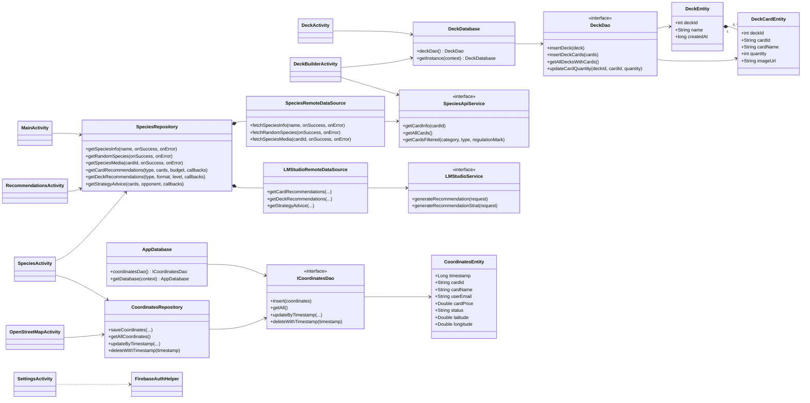
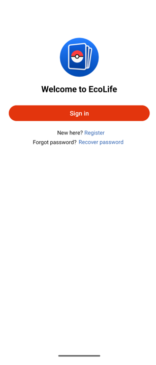
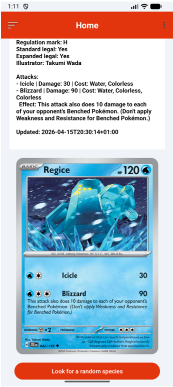
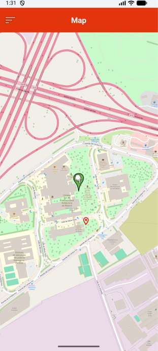
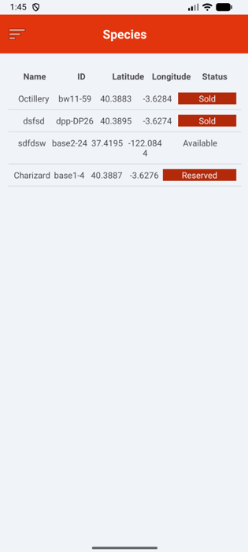
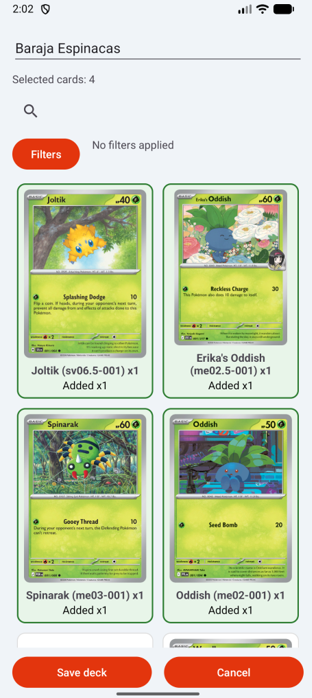
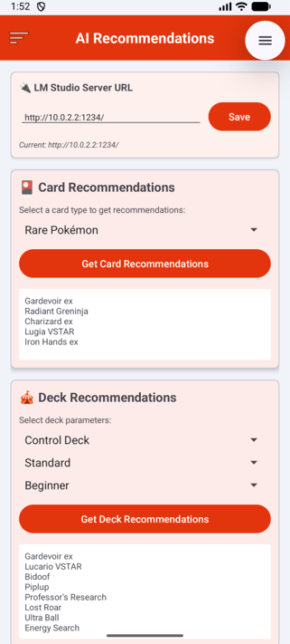

# Pokémon TCG Companion

[](https://github.com/emilpintilie/pokemon-tcg-companion-android/releases)
[](app/build.gradle.kts)
[](gradle/libs.versions.toml)
[](gradle/wrapper/gradle-wrapper.properties)
[](#main-dependencies)
[](LICENSE)

An Android application for discovering Pokémon TCG cards, publishing their location and availability, managing local decks, and requesting recommendations from a language model running in LM Studio.

## Features

### Card catalog and details

- Displays a random card on the home screen.
- Retrieves complete card details by identifier or name through the public TCGdex API.
- Displays images, attacks, weaknesses, resistances, legality, variants, and prices whenever those fields are available from the API.
- Uses a local placeholder when a card image is unavailable.

### Trading map

- Displays the user's current location on OpenStreetMap.
- Allows users to register a card at a location by pressing and holding for between 1.5 and 3 seconds.
- Stores the card identifier, name, seller, email address, price, status, and coordinates.
- Supports the `Available`, `Sold`, `Reserved`, and `Unavailable` statuses.
- Synchronizes records between Room and Firebase Realtime Database.

### Record management

- Lists registered cards and displays their locations on an embedded map.
- Retrieves additional information and images from TCGdex.
- Allows users to edit the identifier, name, and status, or delete a record after confirmation.

### Deck building

- Creates and edits decks stored exclusively on the device.
- Searches for cards by name or identifier and filters them by category and type.
- Supports **Standard**—regulation marks `H`, `I`, and `J`—and **Expanded**—the complete catalog—formats.
- Allows users to add multiple copies, adjust quantities, and remove cards.
- Renders the catalog progressively: 48 cards initially, followed by batches of 24.

> The deck builder requires a name and at least one card, but it does not currently enforce the official 60-card limit or copy restrictions. The Standard selection reflects the regulation marks hardcoded in this version and must be updated when the official rotation changes.

### Local AI assistant

- Generates card recommendations based on type, collection, and budget.
- Suggests decks based on strategy, format, and player experience.
- Provides advice for specific matchups.
- Processes requests locally through LM Studio using the model configured as `google/gemma-4-e4b`.

### Account and preferences

- Registration, sign-in, sign-out, and password recovery through Firebase Authentication.
- Profile display name editing.
- Persistent dark mode.
- Location update controls.
- Shared navigation through a side drawer.

## Operating conditions

| Feature | Requirement | Behavior when unavailable |
|---|---|---|
| Application access | An authenticated Firebase account | The user is redirected to the authentication screen |
| Catalog and images | Internet access and TCGdex availability | Remote data is not loaded; the placeholder image is used when applicable |
| Maps | Internet access to download OpenStreetMap tiles | Local data remains available, but the map may be incomplete |
| Current location | Precise or approximate location permission and an active location provider | The map starts at a default location in Madrid |
| Listing synchronization | A configured Firebase project, network access, and valid security rules | Room records remain local until synchronization succeeds |
| Decks | Internet access for the catalog and images; not required to read previously saved data | Local decks remain available, but the remote catalog cannot be refreshed |
| AI recommendations | LM Studio running with the model loaded and the server reachable on port `1234` | The request fails or times out after 120 seconds |

## Requirements

- Android Studio with support for Android Gradle Plugin 8.8.1.
- JDK 17 or later to run Android Gradle Plugin 8.8.1. The source code targets Java/JVM 11 compatibility.
- Android SDK 35.
- A device or emulator running Android 7.0 (API 24) or later.
- A Firebase project with **Email/Password Authentication** and **Realtime Database** enabled.
- LM Studio only when using the AI assistant.

## Installation and configuration

1. Clone the repository:

   ```bash
   git clone https://github.com/emilpintilie/pokemon-tcg-companion-android.git
   cd pokemon-tcg-companion-android
   ```

2. Open the project root in Android Studio and wait for Gradle synchronization to finish.

3. Configure Firebase:

   - create or select a Firebase project;
   - register an Android application with the package name `es.upm.pokemonapp`;
   - enable the Email/Password provider in Authentication;
   - create a Realtime Database instance and define appropriate rules for the environment;
   - copy `app/google-services.json.example` to `app/google-services.json` and replace the placeholders with the configuration downloaded from Firebase.

4. Connect a device or start an emulator running API 24 or later.

5. Build and install the development variant:

   ```bash
   ./gradlew assembleDebug
   ./gradlew installDebug
   ```

On Windows, use `gradlew.bat` instead of `./gradlew`.

## LM Studio configuration

The integration uses the `POST /api/v1/chat` endpoint, port `1234`, and the `google/gemma-4-e4b` model by default.

1. Install LM Studio and download a model compatible with that identifier, or change `MODEL_NAME` and the models used by the requests in the source code.
2. Start the LM Studio local server on port `1234`.
3. From the official Android emulator, the application uses `http://10.0.2.2:1234/` to reach the host machine.
4. Genymotion must use `http://10.0.3.2:1234/`.
5. On a physical device, use the computer's LAN address, such as `http://192.168.1.42:1234/`, and allow the connection through the firewall.

> Known limitation: the server URL field on the recommendations screen updates the displayed text but does not recreate the network client yet. The data source currently uses `http://10.0.2.2:1234/`; using a physical device requires changing the default value in `LMStudioRemoteDataSource` and rebuilding the application.

The application allows unencrypted HTTP traffic to communicate with the local server. This configuration is suitable for development on a trusted network, not for exposing the service to the Internet.

## Basic usage

1. Register an account or sign in.
2. View a random card from **Home**.
3. Open **Map**, grant location permission, and press and hold to register a card.
4. Use **Species** to review, edit, or delete records.
5. In **Deck**, select a format, filter the catalog, and create a local deck.
6. Open **AI Recommendations** after preparing the LM Studio server.
7. Adjust the theme, location settings, and display name from **Settings**.

## Architecture and data

The application uses Activities with View Binding for its interface, a Repository/Data Source layer for remote access, and two independent Room databases.

```text
Activities / View Binding
├── SpeciesRepository
│   ├── TCGdex · Retrofit
│   └── LM Studio · Retrofit
├── coordinates_database · Room ↔ Firebase Realtime Database
└── deck_local_database · Room (local only)
```

| Store | Content | Scope |
|---|---|---|
| `coordinates_database` | Published cards, user, price, status, and coordinates | Local, with bidirectional synchronization to `coordinates` in Firebase |
| `deck_local_database` | Decks, cards, and quantities | Device only; not synchronized with Firebase |
| `SharedPreferences` | Theme and location update status | Device only |

### UML diagram



## Main dependencies

| Component | Version | Purpose |
|---|---:|---|
| Kotlin | 1.9.24 | Primary programming language |
| Android Gradle Plugin | 8.8.1 | Android build system |
| Gradle Wrapper | 8.14.5 | Build automation |
| AndroidX Room | 2.6.1 | Local persistence |
| Retrofit | 2.11.0 | HTTP clients |
| OkHttp | 4.11.0 | HTTP transport and logging |
| Glide | 4.16.0 | Image loading |
| Firebase Authentication KTX | 22.3.1 | User identity |
| Firebase Realtime Database KTX | 20.3.0 | Record synchronization |
| FirebaseUI Auth | 8.0.2 | Integrated sign-out |
| osmdroid | 6.1.17 | OpenStreetMap integration |
| Kotlin Coroutines | 1.7.3 | Asynchronous work |

The complete and authoritative dependency declarations are available in [`app/build.gradle.kts`](app/build.gradle.kts) and [`gradle/libs.versions.toml`](gradle/libs.versions.toml).

## Privacy, security, and limitations

- Map records include the user's name, email address, and coordinates, and are synchronized under the global `coordinates` node. Firebase rules must restrict read and write access according to the project's policy before real data is used.
- `google-services.json` identifies the Firebase project, but sensitive server credentials must never be included in the application or repository.
- AI-generated recommendations are advisory: they may be inaccurate and do not replace verification against official rules, legality, or pricing sources.
- Card availability, prices, images, and legality depend on data supplied by TCGdex.
- Map tiles and geographic data are subject to OpenStreetMap's usage and attribution policies.
- The deck database uses destructive migration; a schema change without a migration may delete local decks.
- Current test coverage is limited to the basic unit and instrumented test templates.

## Screenshots

| Authentication | Home | Map |
|---|---|---|
|  |  |  |

| Records | Deck builder | AI recommendations |
|---|---|---|
|  |  |  |

## Contribution checks

Before proposing changes, run:

```bash
./gradlew test
./gradlew assembleDebug
```

Do not commit private keys, signing files, local properties, or credentials. See [`SECURITY.md`](SECURITY.md) for the repository's handling rules. When data must be preserved, accompany Room schema changes with a suitable migration strategy.

## Team

- Raúl Sánchez de Saboya — `rass08914@gmail.com`
- Emil Stelian Pintilie — `emil.pintilie.dev@protonmail.com`
- Óscar Domínguez - `oscardomingard@proton.me`
- Pablo García

## License

Distributed under the MIT License. See [`LICENSE`](LICENSE) for its terms.

Pokémon and Pokémon TCG are trademarks of their respective owners. This is an independent academic project and is not affiliated with or endorsed by Nintendo, Game Freak, Creatures Inc., or The Pokémon Company.
